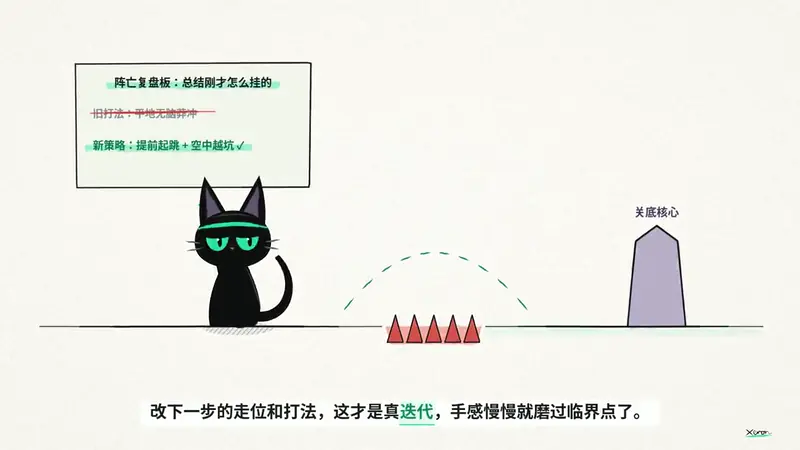
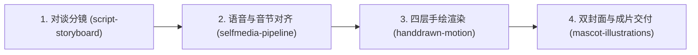

<div align="center">

# Handdrawn Video Skills

**从一句选题到 60fps 水彩手绘成片 — 专为 Gemini Web Tasks 打造的 4-Skill 端到端视频生产工作流**

[](LICENSE)
[](pyproject.toml)
[](docs/gemini-web-tasks-guide.md)
[](skills/handdrawn-motion/SKILL.md)
[](pyproject.toml)

[流水线](#流水线) · [5 分钟上手](#5-分钟上手) · [双轨版本](#双轨版本) · [核心引擎与目录](#核心引擎与目录) · [致谢与协议](#致谢与协议)

</div>

<p align="center">
  
</p>
<p align="center">
  <sub>真实成片节选：由本套 4-Skill 流水线在 Gemini Web Tasks 端到端自动渲染（仓库内 12fps 循环 WebP 预览）</sub>
</p>

---

## 流水线

告别硬邦邦的“AI 模板几何”与 PPT 淡入淡出。输入一个想法，自动跑完采写排雷、一镜配音、PyCairo 水彩手绘渲染与双封面交付：



---

## 5 分钟上手

> 完整图文教程与故障排查见 **[Gemini Web Tasks 实操手册](docs/gemini-web-tasks-guide.md)**；自定义 IP 或迁移至 Claude Code / Codex / 本地 `uv` 见 **[自定义 IP 与移植指南](docs/ip-porting-guide.md)**。

1. **打包平铺根目录 `.zip`**（每个 ZIP 根目录直接包含 `SKILL.md`，输出至 `dist/`）：

   ```bash
   git clone https://github.com/xeronsh/handdrawn-video-skills.git
   cd handdrawn-video-skills
   uv run scripts/package_zips.py --track all
   ```

2. **上传 4 个独立 Skill ZIP**：打开 Gemini Web Tasks **Skills 管理界面**，逐个上传 `dist/generic/`（通用可换 IP 版）或 `dist/xeron/`（原版黑猫预设）下的 **4 个独立 `.zip`**（不要上传合集包）。

3. **发送启动 Prompt**：

   ```text
   我想做一期 2 分钟左右的手绘科普短视频，主题是「为什么 AI 写代码越到后期越容易跑偏」。
   请先调用 script-storyboard 用 2 轮简短提问敲定核心物理比喻、完成合规排雷并输出逐字稿与分镜；
   确认后走 selfmedia-pipeline 完整出片，按默认规范交付 60fps 成片、3:4 + 4:3 双封面与发布文案包。
   ```

---

## 双轨版本

| 维度 | Track A：`skills/`（通用可换 IP 模板，推荐） | Track B：`presets/xeron/`（原版黑猫四件套） |
| :--- | :--- | :--- |
| **定位** | 开源可移植模板，通过 [`ip-profile.example.yaml`](templates/ip-profile.example.yaml) 自定义角色、配色与平台 | 保留原版 `#2EE59D` 薄荷绿眼黑猫视觉与符号接口，零破坏兼容 |
| **4 个 Skill** | `selfmedia-pipeline` / `script-storyboard` / `mascot-illustrations` / `handdrawn-motion` | `xeron-selfmedia-pipeline` / `xeron-script-storyboard` / `xeron-cat-illustrations` / `xeron-cat-motion` |
| **打包产物** | `dist/generic/*.zip` | `dist/xeron/*.zip` |
| **详细文档** | [`skills/selfmedia-pipeline/SKILL.md`](skills/selfmedia-pipeline/SKILL.md) · [自定义 IP 与移植指南](docs/ip-porting-guide.md) | [`presets/xeron/README.md`](presets/xeron/README.md) · [Gemini Web Tasks 实操手册](docs/gemini-web-tasks-guide.md) |

---

## 核心引擎与目录

核心动画引擎采用 **导演 · 材质 · 工程与质检** 分层解耦（完整规范见 [`director-and-style-rules.md`](skills/handdrawn-motion/references/director-and-style-rules.md)）：

- **Layer 1 · 手绘水彩介质**：2.5 头身闭合剪影 + 冷压水彩纸 (`#FAF8F3`) + 湿边晕染 + 蘸水笔 `12fps` 独立手绘抖动叠加 `60fps` 主运动 + CJK 缺字保护。
- **Layer 2 · 单拍读点与声画同构**：`Lead Eye -> Anticipation -> Fast Snap -> Payoff Hold` 节拍包络、关节相位错峰，结合单次 `<short pause>` 口播元音音核字幕对齐与立体声 Lo-Fi BGM。
- **Layer 3 · 一镜连续世界摄影机**：持久化二维世界坐标与闭合轮廓变形，气口谷值平滑横移转场，彻底告别 PPT 淡入淡出。
- **Layer 4 · 3-Zoom 自动审片门禁**：全片 `1080p 60fps` 编码前自动检查字幕带墨水密度、运动条防闪烁与 `1:1` 局部接触裁切，杜绝穿帮与 `☐` 豆腐块。

> **本地运行依赖**（Gemini Web Tasks 云端沙盒已内置）：Python `>= 3.11`、`uv sync`（可选 `--extra fonts`），系统安装 `ffmpeg`、`cairo`（`libcairo2-dev` / `cairo`）与 Noto CJK 字体；环境变量覆盖与排查见 [移植指南](docs/ip-porting-guide.md)。

```text
handdrawn-video-skills/
├── skills/               # Track A：通用可换 IP 四件套
├── presets/xeron/        # Track B：原版黑猫四件套（零破坏兼容）
├── templates/            # ip-profile.example.yaml 单文件 IP 与平台配置
├── scripts/              # package_zips.py 零依赖平铺根目录 ZIP 打包脚本
├── docs/                 # Gemini Web Tasks 手册、IP 移植指南与 assets/demo.webp
├── pyproject.toml        # uv / Python >=3.11 依赖配置
└── LICENSE               # MIT License
```

---

## 致谢与协议

本项目的导演分层架构、程序化手绘介质与自动化审片思路受益于以下开源项目：**Lemo-Opuscar** · **ClaudeAnimationBase** · **Bang Motion** · **cth9191/animate** · **xiaoma-studio** · **chaojifeng-video-design**。

基于 **[MIT License](LICENSE)** 开源（`Copyright (c) 2026 xeronsh`）。
