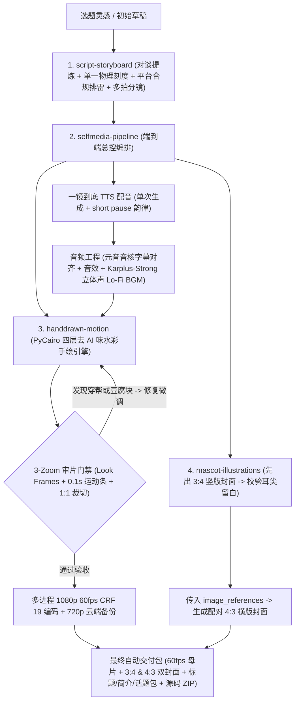

<div align="center">

# Handdrawn Video Skills

**端到端 AI 手绘动画短视频四件套 Skill 工作流**

*End-to-End 4-Skill AI Hand-Drawn Animated Explainer Video Suite — Anti-AI Watercolor Craft, Single-Take Prosody Audio, Dual Covers & Copy Bundle*

[](LICENSE)
[](pyproject.toml)
[](docs/gemini-web-tasks-guide.md)
[](skills/handdrawn-motion/SKILL.md)
[](pyproject.toml)

[核心特性](#核心特性) · [端到端生产流水线](#端到端生产流水线) · [双轨版本对比](#双轨版本对比) · [5 分钟上手](#5-分钟上手-gemini-web-tasks) · [自定义 IP 移植](#自定义-ip-与跨平台移植) · [四层去 AI 味引擎](#四层去-ai-味手绘动画引擎) · [仓库结构](#仓库目录结构)

</div>

---

> **为什么做这套工作流？**
> 绝大多数 AI 生成的代码视频都带着浓重的“AI 模板味”——硬邦邦的矢量方块、机械同步的线性补间、生硬的 PPT 淡入淡出，以及配音和字幕错位。
> **Handdrawn Video Skills** 将一套经过完整成片验证的 **4-Skill 自媒体生产流水线** 沉淀为可直接导入 **Gemini Web Tasks**（并可平滑迁移至 Claude Code / Codex / 本地 `uv`）的标准 Skill 套件：从一句选题出发，自动完成**对谈采写与合规排雷 -> 一镜到底配音与元音字幕咬合 -> 四层去 AI 味 PyCairo 手绘水彩 60fps 渲染 -> 3-Zoom 审片门禁 -> 成对 `3:4` + `4:3` 双封面与全平台发布文案包**。

---

## 核心特性

- **四层去 AI 味手绘动画架构**：以 **2.5 头身手绘吉祥物剪影 + 冷压水彩纸 (`#FAF8F3`) + 湿边水彩晕染 + 蘸水笔 12fps 独立手绘抖动** 替代“程序员几何拼图”，彻底告别 PPT 幻灯片淡入淡出，改用一镜连续世界摄影机与气口横移转场。
- **一镜到底口播与元音音核字幕零漂移**：单次 `<short pause>` 韵律配音（严禁 `atempo` 变速与切气口），直接在未剪辑 Studio WAV 上提取 `280–3200 Hz` 元音音核峰值与 `-38.0 dB` 气口谷值对齐 `40px` 字幕，叠加立体声 Karplus-Strong 吉他 Lo-Fi BGM。
- **3-Zoom 全幕审片门禁**：全片 `60fps` 编码前强制跑 `lint_and_render_3zoom_qa` 与视觉抽查，杜绝 `☐` 缺字豆腐块、字幕区墨水侵入与耳尖/箭头穿帮。
- **成片即自动交付全套发布资产**：每次出片默认交付 `1920x1080 @ 60fps (CRF 19)` 母片、`3:4` 竖版 + `4:3` 横版成对双封面、可直接粘贴的标题 / 简介 / 话题文案包，以及 `<10MB` `720p` 备份与源码包。
- **双轨结构，开箱即用又易二次定制**：提供完全 IP 无关的通用移植版 [`skills/`](skills/selfmedia-pipeline/SKILL.md) 与 100% 向后兼容的原版黑猫预设 [`presets/xeron/`](presets/xeron/README.md)，通过同一套打包脚本一键输出平铺根目录 `.zip`。

---

## 端到端生产流水线



---

## 双轨版本对比

仓库采用**双轨架构（Dual-Track Layout）**，既满足开源社区“换上自己 IP 就能用”的诉求，又完整保留原版黑猫工作流的 100% 兼容性：

| 对比维度 | Track A：`skills/`（通用可移植版，推荐） | Track B：`presets/xeron/`（原版黑猫预设） |
| :--- | :--- | :--- |
| **定位与受众** | 开源社区开发者与自媒体创作者，用于打造**自有角色 IP**与自定义平台流水线 | 需要 100% 复刻原版 `#2EE59D` 薄荷绿眼黑猫手绘风格与历史脚本接口的用户 |
| **4 个 Skill 名称** | `selfmedia-pipeline` / `script-storyboard` / `mascot-illustrations` / `handdrawn-motion` | `xeron-selfmedia-pipeline` / `xeron-script-storyboard` / `xeron-cat-illustrations` / `xeron-cat-motion` |
| **IP 与配色解耦** | 通过 [`templates/ip-profile.example.yaml`](templates/ip-profile.example.yaml) 与 `BrandConfig` 参数化配置 | 保留原版黑猫视觉锁定、薄荷绿 `#2EE59D` 强调色与完整兼容符号 |
| **动画引擎脚本** | `cairo_handdrawn.py` / `chibi_watercolor_kit.py` / `motion_rig_kit.py` | `cairo_handdrawn.py` / `v14_chibi_watercolor_kit.py` / `xeron_clean_rig.py` |
| **平台合规与封面** | 支持 Douyin / Bilibili / Xiaohongshu / YouTube 可配置预设 | 默认抖音 / B 站工作流（含抖音多模态防雷盾与 `3:4` + `4:3` 双封面） |
| **一键打包命令** | `uv run scripts/package_zips.py --track generic --out dist` | `uv run scripts/package_zips.py --track xeron --out dist` |
| **独立上传 ZIP** | `dist/generic/{selfmedia-pipeline,script-storyboard,mascot-illustrations,handdrawn-motion}.zip` | `dist/xeron/{xeron-selfmedia-pipeline,xeron-script-storyboard,xeron-cat-illustrations,xeron-cat-motion}.zip` |
| **完整合集 ZIP** | `dist/generic/handdrawn-video-skills-generic-suite.zip` | `dist/xeron/xeron-skills-suite.zip` |

> **Skill 与源文件映射**：查看 Track A 总控入口 [`skills/selfmedia-pipeline/SKILL.md`](skills/selfmedia-pipeline/SKILL.md)，或查看 Track B 专属说明 [`presets/xeron/README.md`](presets/xeron/README.md)。

---

## 5 分钟上手 Gemini Web Tasks

完整图文操作与排障请阅读 **[Gemini Web Tasks 实操手册](docs/gemini-web-tasks-guide.md)**。核心只需 3 步：

### Step 1：一键打包平铺根目录 `.zip`

Gemini Web Tasks Skills UI 要求每个 Skill 的 `.zip` **根目录直接包含 `SKILL.md`**。使用仓库内置的零外部依赖脚本 [`scripts/package_zips.py`](scripts/package_zips.py) 生成：

```bash
git clone https://github.com/xeronsh/handdrawn-video-skills.git
cd handdrawn-video-skills

# 仅打包通用移植版（推荐新用户）-> 输出到 dist/generic/
uv run scripts/package_zips.py --track generic --out dist

# 或仅打包原版黑猫预设 -> 输出到 dist/xeron/
uv run scripts/package_zips.py --track xeron --out dist

# 或一次性打包双轨全部 ZIP
uv run scripts/package_zips.py --track all --out dist
```

### Step 2：在 Gemini Web Tasks 中上传 4 个独立 Skill ZIP

打开 Gemini Web Tasks 的 **Skills 管理界面**，逐个上传所选轨道下的 **4 个独立 `.zip`**（不要上传合集包）：

- **Track A（通用版）**：`selfmedia-pipeline.zip`、`script-storyboard.zip`、`mascot-illustrations.zip`、`handdrawn-motion.zip`
- **Track B（原版预设）**：`xeron-selfmedia-pipeline.zip`、`xeron-script-storyboard.zip`、`xeron-cat-illustrations.zip`、`xeron-cat-motion.zip`

### Step 3：复制开箱即用的启动 Prompt

**场景 A — 只有一个模糊选题，先对谈采写再出片：**

```text
我想做一期 2 分钟左右的手绘科普短视频，主题是「为什么 AI 写代码越到后期越容易跑偏（上下文腐烂与工程护栏）」。
请先调用 script-storyboard 通过 2 轮简短提问帮我敲定核心物理比喻、完成合规排雷并输出逐字稿与多拍分镜；
等我确认脚本后，再走 selfmedia-pipeline 完整出片，按默认规范交付 60fps 成片、3:4 + 4:3 双封面和发布文案包。
```

**场景 B — 已有确认好的逐字稿，直接进入端到端出片：**

```text
请调用 selfmedia-pipeline 把下面这段口播逐字稿做成 16:9 60fps 手绘水彩动画视频：
1. 先过一遍目标平台合规体检和单一物理刻度校验；
2. 用单次 <short pause> 韵律配音 + 元音音核字幕对齐 + 立体声 Lo-Fi BGM；
3. 全片编码前先给我看 3-Zoom 审片接触表；
4. 完成后自动交付 1080p 成片、3:4 + 4:3 配对双封面、标题/简介/话题包。

[在此粘贴你的逐字稿]
```

---

## 自定义 IP 与跨平台移植

3 步将整套工作流切换为你自己的角色 IP、配色体系与运行环境，详细步骤见 **[自定义 IP 与多运行时移植指南](docs/ip-porting-guide.md)**：

1. **定义 IP 与平台档案**：复制 [`templates/ip-profile.example.yaml`](templates/ip-profile.example.yaml)，填写 `brand`（名称/水印）、`mascot`（物种/剪影/视觉锁定）、`palette`（主强调色，默认 `#2EE59D`）、`voiceover`、`platform`（Douyin / Bilibili / Xiaohongshu / YouTube）与 `subtitles.highlight_keywords`。
2. **同步静态画风与动画 `BrandConfig`**：将视觉锁定同步到 [`skills/mascot-illustrations/references/ip-and-style-dna.md`](skills/mascot-illustrations/references/ip-and-style-dna.md)；动画渲染前在 [`skills/handdrawn-motion/scripts/cairo_handdrawn.py`](skills/handdrawn-motion/scripts/cairo_handdrawn.py) 中一行加载配置即可全局注入配色、关键词与 `draw_brand_signature` 书法签名（兼容有无 PyYAML 环境）：
   ```python
   from cairo_handdrawn import BrandConfig, set_brand_config
   set_brand_config(BrandConfig.from_file("templates/ip-profile.example.yaml"))
   ```
3. **多运行时无缝部署**：
   - **Gemini Web Tasks**：重新运行 `uv run scripts/package_zips.py --track generic --out dist` 并覆盖上传对应 `.zip`。
   - **Claude Code / Codex**：直接将 `skills/` 下 4 个目录复制到 `.claude/skills/` 或 Agent 的 `skills/` 目录即可自动发现。
   - **本地 `uv` 环境**：执行 `uv sync`（如需 CJK 缺字预检加 `--extra fonts`），接入任意本地/API TTS 与生图工具即可在本地渲染 `1080p 60fps` 成片。

---

## 四层去 AI 味手绘动画引擎

核心渲染引擎位于 [`skills/handdrawn-motion/`](skills/handdrawn-motion/SKILL.md)（架构规范详见 [`director-and-style-rules.md`](skills/handdrawn-motion/references/director-and-style-rules.md)），严格解耦 **导演 (`DIRECTOR`) · 材质 (`STYLE`) · 工程与质检 (`TECHNIQUE`)**：

| 架构层级 | 核心机制与关键实现 | 解决的痛点 |
| :--- | :--- | :--- |
| **Layer 1 · 造型与自然水彩介质** | 2.5 头身闭合剪影角色 + 冷压水彩纸 (`#FAF8F3`) + 预加密湿边水彩晕染 (`max_px <= 10.5px`) + 压感蘸水笔 (`brush_stroke`) + 独立 `12fps` (`onTwos`) 手绘抖动叠加 `60fps` 主运动 + CJK 缺字保护 | 消除“几何图形硬拼”、“塑料纯白死感”与汉字 `☐` 豆腐块 |
| **Layer 2 · 观众单拍读点与声画同构** | `viewer_read_envelope`（`Lead Eye 0.30–0.40s` -> `Reverse Anticipation 0.15–0.20s` -> `Fast Snap 0.22–0.28s` -> `Payoff Hold 0.85–1.20s`）+ 关节相位错峰（眼 -> 头 `+3f` -> 躯干 `+6f` -> 四肢 -> 耳尾）+ 单一物理刻度比喻 | 消除“全屏同时乱动、看完记不住重点”的机械同步感 |
| **Layer 3 · 一镜连续世界摄影机** | `ContinuousCamera2D` 持久化二维世界坐标 + `shape_morph_poly` 闭合轮廓变形 + 气口谷值平滑横移 (`0.48–0.60s` `smootherstep`) | 彻底消灭 PPT 幻灯片式的透明度淡入淡出切幕 |
| **Layer 4 · 三倍率审片门禁 (`3-Zoom QA`)** | `lint_and_render_3zoom_qa`：Gate 1 自动检查 `y >= 938` 字幕带墨水密度 (`< 16%`) 与 `1080p` Look Frames（`qa_look_*.png`）；Gate 2 `0.10s` `8–10` 帧运动条（默认 `strip_count=8`，`qa_motion_strip.png`）与 `+16.7ms` 防闪烁检测（`< 5.0%`）；Gate 3 `420x420` `1:1` 局部接触裁切（`qa_crops_1to1.png`） | 杜绝盲目耗时渲染后才发现穿帮、悬空脚或字幕撞图 |
| **音频与编码底座** | 单次 `<short pause>` 配音（禁 `atempo`）+ `align_subs_on_raw_vowel_peaks`（`280–3200 Hz` 元音峰值 / `-38.0 dB` 气口）+ Karplus-Strong 立体声吉他 Lo-Fi BGM（人声 `0.28` / 气口 `0.58`）+ 多进程分片 `encode_turbo_film` (`H.264 CRF 19`) | 保证整片音色语速 100% 统一、重音字与特效帧级咬合 |

---

## 仓库目录结构

```text
handdrawn-video-skills/
├── README.md                                          # 项目总览（当前文档）
├── LICENSE                                            # MIT 开源协议
├── pyproject.toml                                     # uv / Python >=3.11 依赖配置
├── .gitignore                                         # 忽略 dist/、虚拟环境与渲染媒体文件
├── docs/
│   ├── gemini-web-tasks-guide.md                      # Gemini Web Tasks 完整实操与排障手册
│   └── ip-porting-guide.md                            # 自定义 IP、平台合规与多运行时移植指南
├── templates/
│   └── ip-profile.example.yaml                        # 单文件 IP 与平台档案模板
├── scripts/
│   └── package_zips.py                                # 零依赖平铺根目录 ZIP 打包脚本
├── skills/                                            # Track A：通用可移植四件套（推荐）
│   ├── selfmedia-pipeline/
│   │   └── SKILL.md                                   # 端到端出片总控流水线
│   ├── script-storyboard/
│   │   └── SKILL.md                                   # 对谈采写、合规排雷与多拍分镜
│   ├── mascot-illustrations/
│   │   ├── SKILL.md                                   # 16:9 概念插画与 3:4 + 4:3 双封面
│   │   └── references/
│   │       ├── ip-and-style-dna.md                    # IP 视觉锁定与 AI 界面/黑话手绘词典
│   │       └── prompt-templates-and-qa.md             # Mode 1.0/2.0/3.0 提示词模板与 QA 清单
│   └── handdrawn-motion/
│       ├── SKILL.md                                   # 四层去 AI 味手绘动画总规范
│       ├── references/
│       │   └── director-and-style-rules.md            # DIRECTOR · STYLE · TECHNIQUE & 3-Zoom QA
│       └── scripts/
│           ├── cairo_handdrawn.py                     # BrandConfig、PyCairo 压感笔刷、12fps 抖动、连续相机与 3-Zoom QA
│           ├── chibi_watercolor_kit.py                # 2.5 头身水彩角色、冷压纸纹理、道具与彩蛋库
│           └── motion_rig_kit.py                      # C/S 脊柱骨骼、Lo-Fi BGM 合成、元音字幕对齐与编码器
└── presets/
    └── xeron/                                         # Track B：100% 兼容原版黑猫预设（已脱敏）
        ├── README.md                                  # 原版黑猫四件套使用与导入说明
        ├── xeron-selfmedia-pipeline/SKILL.md
        ├── xeron-script-storyboard/SKILL.md
        ├── xeron-cat-illustrations/
        │   ├── SKILL.md
        │   └── references/
        │       ├── ip-and-style-dna.md
        │       └── prompt-templates-and-qa.md
        └── xeron-cat-motion/
            ├── SKILL.md
            ├── references/director-and-style-rules.md
            └── scripts/
                ├── cairo_handdrawn.py
                ├── v14_chibi_watercolor_kit.py
                └── xeron_clean_rig.py
```

---

## 系统依赖

如果仅在 **Gemini Web Tasks** 网页端运行，云端 Linux 沙盒已预装基础环境，本地只需 Python / `uv` 运行打包脚本即可。若需要在**本地机器**运行渲染脚本，请准备以下依赖：

- **Python & 包管理**：Python `>= 3.11` 与 [`uv`](https://docs.astral.sh/uv/)
- **系统级依赖**：`ffmpeg`、`cairo`（编译/运行 `pycairo` 所需）、CJK Noto 字体（`NotoSansCJK-Regular.ttc` / `NotoSansCJK-Bold.ttc` / 可选 `NotoSerifCJK-Bold.ttc`）

```bash
# Debian / Ubuntu（与 Gemini Web Tasks Linux 沙盒一致）
sudo apt-get update && sudo apt-get install -y \
  ffmpeg libcairo2-dev pkg-config fonts-noto-cjk

# macOS (Homebrew)
brew install ffmpeg cairo pkg-config font-noto-sans-cjk

# 安装 Python 依赖（可选 --extra fonts 开启 fontTools CJK 缺字静态扫描）
uv sync
uv sync --extra fonts
```

> 本地非标准字体路径可通过环境变量覆盖：`HANDDRAWN_FONT_REGULAR`、`HANDDRAWN_FONT_BOLD`、`HANDDRAWN_FONT_SERIF`。

---

## 致谢与开源协议

### 致谢（Acknowledgements）

本项目的导演分层架构、程序化手绘介质与自动化审片门禁深度受益于以下开源代码动画与视频工作流项目：

- **Lemo-Opuscar**
- **ClaudeAnimationBase**
- **Bang Motion**
- **cth9191/animate**
- **xiaoma-studio**
- **chaojifeng-video-design**

### 开源协议（License）

本项目基于 **[MIT License](LICENSE)** 开源（`Copyright (c) 2026 xeronsh`）。欢迎自由使用、修改、定制自有 IP 并用于个人或商业创作。
